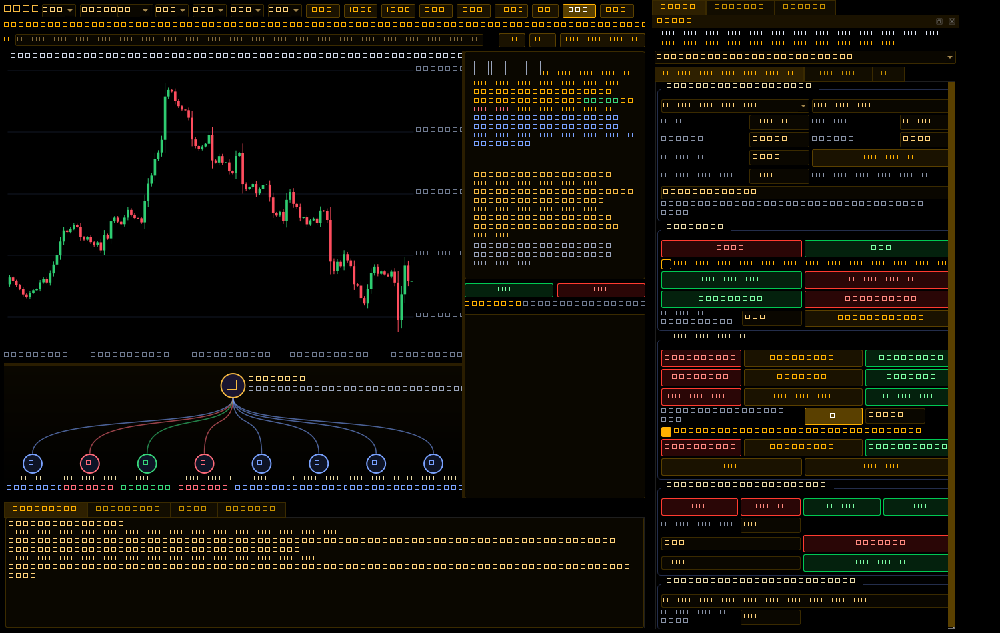

# Python Crypto Workspace — kết quả kiểm chứng

Người dùng đã xác nhận giữ Python gốc và bổ sung tính năng, thay vì chuyển sang giao diện WPF.

- `python/original/AI_MT_Trading.py` giữ nguyên SHA-256 của tệp được gửi: `b6265fb39c54e0235926be87544c5cdf177ad7728e33d582ff0fdc3554fc0909`.
- Linux/Qt offscreen: **209 tests passed**, không skip. Kiểm tra bốn tab/Panel/Chat/AI Web và tám phương pháp gốc; catalog/candle/volume các nguồn public; WebSocket; khử trùng native/aggregate prints; chart tabs độc lập; AI đủ bối cảnh và loại nguồn/symbol/generation/nonce đã cũ; hotkey xác nhận/trực tiếp/giữ lặp; chặn lệnh mở từ chart nghiên cứu; dữ liệu cũ và walk-forward không nhìn tương lai.
- Smoke test source chạy thành công: thêm chart MT5 mô phỏng thật của broker demo, tab `+`, tám kết quả phân tích, prompt workspace, HK mặc định cần xác nhận, nghiên cứu chặn lệnh MT5, demo prints/depth. Không giả dữ liệu live crypto trong smoke test.
- Workflow Windows sẽ chạy cùng tests, đóng gói PyInstaller và mở chính EXE trước khi phát hành. [Theo dõi bản hiện tại](https://github.com/phungbaunam1-hub/py/actions/workflows/python-original.yml); [Releases](https://github.com/phungbaunam1-hub/py/releases).
- Probe thực tế của cloud nhận 0/7 snapshot vì proxy chặn CONNECT 403; không nhầm với kiểm thử API live thành công. Workflow Windows tạo báo cáo truy cập riêng `public-market-probe.json` theo vùng runner.
- Nguồn MT5 thật cần broker cung cấp trade prints/DOM và terminal/tài khoản của người dùng; chưa chạy bằng tài khoản thật. AI API chưa được xác minh bằng credentials. Rithmic vẫn chưa có SDK/adapter chính thức.
- `scripts/setup-cloud-python.sh` đã chạy thành công trong môi trường cloud; cấu hình cài đặt/khởi động đã được lưu vào draft môi trường.

Ảnh bản khôi phục trước đây dưới đây được lấy từ chính EXE chạy trên Windows CI #2; ảnh Crypto Workspace mới được đính kèm cùng release:

