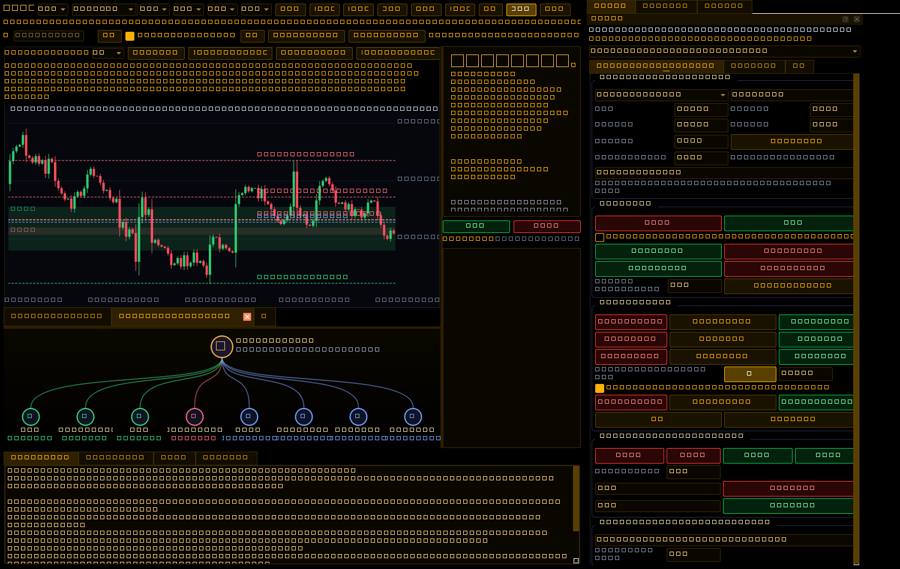

# Python Crypto Workspace — kết quả kiểm chứng

Người dùng đã xác nhận giữ Python gốc và bổ sung tính năng, thay vì chuyển sang giao diện WPF.

- `python/original/AI_MT_Trading.py` giữ nguyên SHA-256 của tệp được gửi: `b6265fb39c54e0235926be87544c5cdf177ad7728e33d582ff0fdc3554fc0909`.
- Linux/Qt offscreen: **254 tests passed**, không skip. Kiểm tra bốn tab/Panel/Chat/AI Web và tám phương pháp gốc; catalog/candle/volume các nguồn public; WebSocket; khử trùng native/aggregate prints; chart tabs độc lập; AI đủ bối cảnh và loại nguồn/symbol/generation/nonce đã cũ; hotkey xác nhận/trực tiếp/giữ lặp; chặn lệnh mở từ chart nghiên cứu; dữ liệu cũ và walk-forward không nhìn tương lai. Có thêm kiểm tra file Python một tệp, spawn/frozen, FIFO/gửi song song theo terminal, hủy queue, native receipts và unknown không phát lại.
- Smoke test source chạy thành công: thêm chart MT5 mô phỏng thật của broker demo, tab `+`, tám kết quả phân tích, prompt workspace, HK mặc định cần xác nhận, nghiên cứu chặn lệnh MT5, demo prints/depth. Không giả dữ liệu live crypto trong smoke test.
- [Windows CI #4](https://github.com/phungbaunam1-hub/py/actions/runs/40052400248) **thành công** ở commit `fcd6e2b`: 254 tests, 0 lỗi/skip; đóng gói `--onefile`, kiểm tra ZIP chỉ có một EXE rồi mở chính EXE. Smoke xác nhận MT5 SDK, WebEngine/helper, bốn tab/tám phương pháp, chart `+`, HK xác nhận, AI context và dispatcher. [Release python-original-4](https://github.com/phungbaunam1-hub/py/releases/tag/python-original-4) có EXE và Python mỗi bản đúng một tệp.
- Đã tải lại cả EXE và Python từ release qua HTTP 200, đối chiếu SHA-256 khớp manifest. EXE Windows x64 có PE machine `0x8664`, 211.597.057 bytes. EXE tự giải nén thư viện khi mở, không cần thư mục `_internal` kèm bên ngoài.
- Probe thực tế của cloud nhận 0/7 snapshot vì proxy chặn CONNECT 403; không nhầm với kiểm thử API live thành công. Workflow Windows tạo báo cáo truy cập riêng `public-market-probe.json` theo vùng runner.
- Probe Windows #4 nhận dữ liệu thật ở OKX spot (1.195 cặp), OKX perpetual (522) và Kraken (1.344, gồm 12 FX): tổng 3.061 instruments, snapshot 60 nến/100 prints/50 mức mỗi phía ở ba thị trường này. Binance/Bybit bị hạn chế truy cập. Đây là kiểm chứng REST, không phải chạy lệnh thật hoặc kiểm chứng WebSocket live.
- Nguồn MT5 thật cần broker cung cấp trade prints/DOM và terminal/tài khoản của người dùng; chưa chạy bằng tài khoản thật. AI API chưa được xác minh bằng credentials. Rithmic vẫn chưa có SDK/adapter chính thức.
- `scripts/setup-cloud-python.sh` đã chạy thành công trong môi trường cloud; cấu hình cài đặt/khởi động đã được lưu vào draft môi trường.

Ảnh dưới đây được lấy từ chính EXE một tệp chạy trên Windows CI #4:

